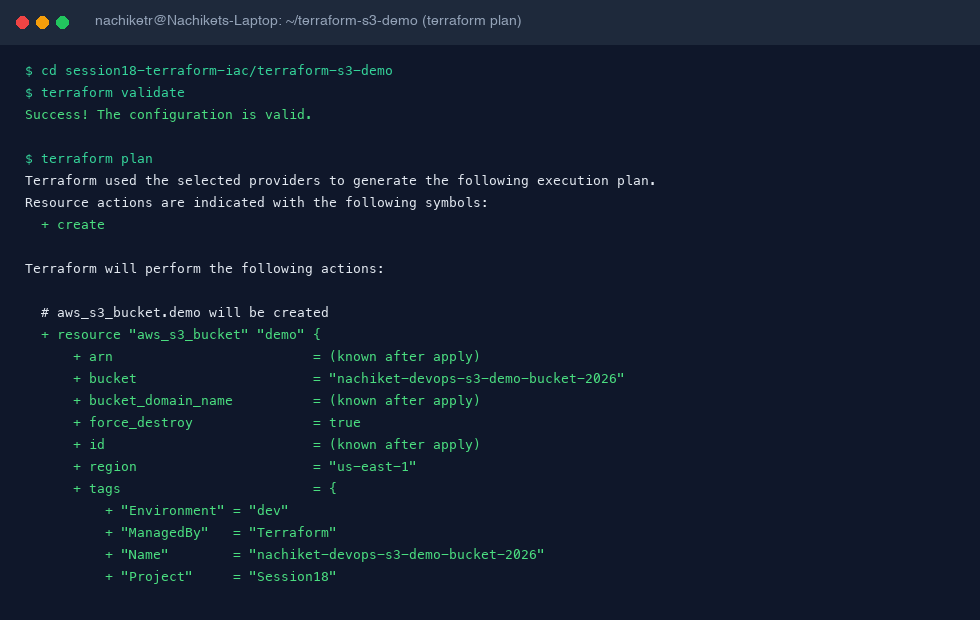
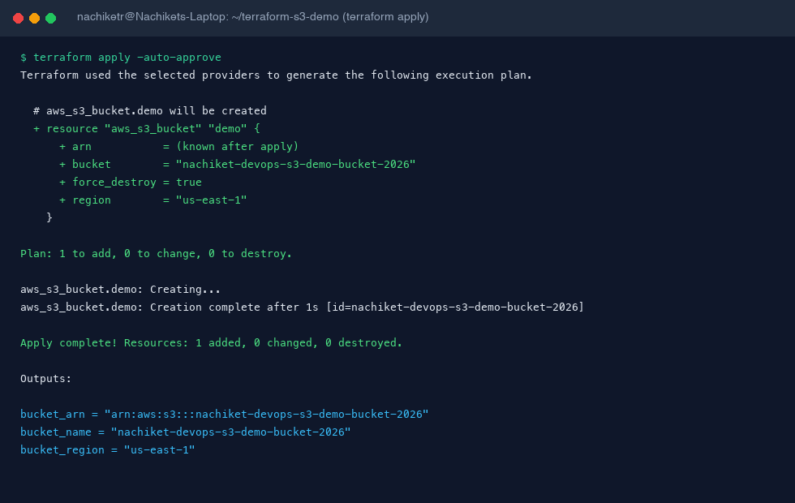
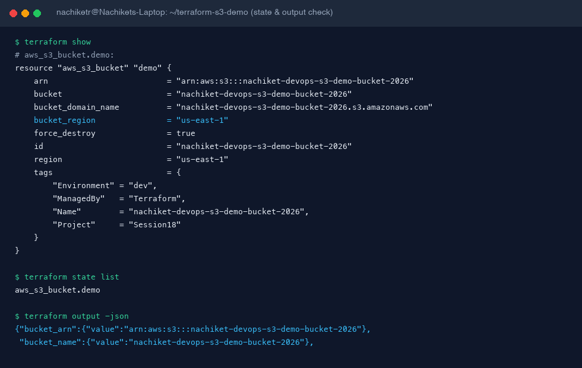
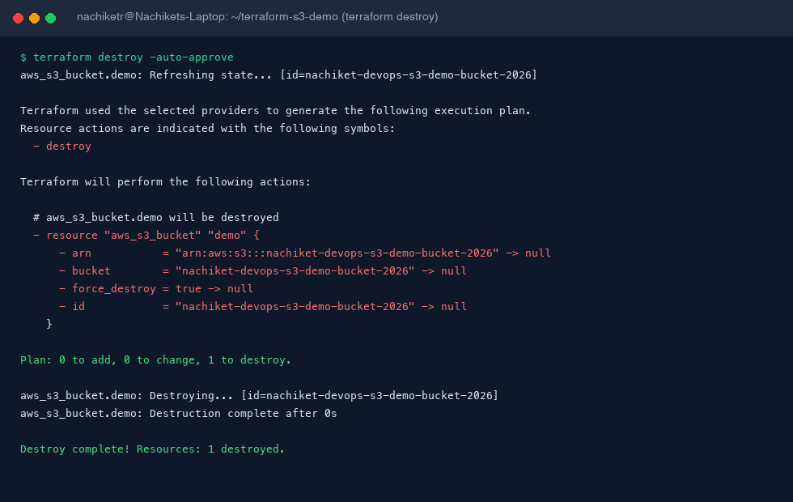

# Session 18: Terraform & Infrastructure as Code (IaC)

This document covers the end-to-end implementation of **Task 1: Terraform S3 Demo** and the research synthesis for **Task 2: AWS Core Services**.

---

## 1. Project Directory Structure

```text
session18-terraform-iac/
├── terraform-s3-demo/
│   ├── main.tf                 # S3 bucket resource definition
│   ├── variables.tf            # Input variable declarations
│   ├── outputs.tf              # Output values (ARN, name, region)
│   ├── provider.tf             # AWS provider and Terraform version constraints
│   ├── terraform.tfvars        # Variable assignment values
│   └── README.md               # S3 project documentation & workflow guide
├── aws-services/
│   ├── 01-iam/
│   │   └── README.md           # Governance, IAM users, roles, policies, PoLP
│   ├── 02-ec2/
│   │   └── README.md           # Compute, AMIs, instance types, EBS, lifecycle
│   ├── 03-s3/
│   │   └── README.md           # Object storage, storage classes, versioning
│   ├── 04-vpc/
│   │   └── README.md           # Virtual networking, CIDR, subnets, IGW, NAT, SGs
│   └── 05-dynamodb-rds/
│       └── README.md           # NoSQL (DynamoDB) vs Relational (RDS) comparison
├── screenshots/                # Workflow output screenshots
└── solution.md                 # Complete Session 18 Solution Document
```

---

## 2. Task 1: Terraform S3 Demo Configuration

### A. Provider Configuration (`provider.tf`)
```hcl
terraform {
  required_version = ">= 1.0.0"
  required_providers {
    aws = {
      source  = "hashicorp/aws"
      version = "~> 5.0"
    }
  }
}

provider "aws" {
  region = var.aws_region
}
```

### B. Variables (`variables.tf`)
```hcl
variable "aws_region" {
  type        = string
  description = "AWS region where the S3 bucket will be created."
  default     = "ap-south-1"
}

variable "bucket_name" {
  type        = string
  description = "Name of the S3 bucket."
  default     = "nachiket-devops-s3-demo-bucket"
}
```

### C. Resource Definition (`main.tf`)
```hcl
resource "aws_s3_bucket" "demo" {
  bucket        = var.bucket_name
  force_destroy = true

  tags = {
    Name        = var.bucket_name
    Environment = "dev"
    ManagedBy   = "Terraform"
    Project     = "Session18"
  }
}
```

### D. Outputs (`outputs.tf`)
```hcl
output "bucket_name" {
  description = "Name of the S3 bucket."
  value       = aws_s3_bucket.demo.bucket
}

output "bucket_arn" {
  description = "ARN of the S3 bucket."
  value       = aws_s3_bucket.demo.arn
}

output "bucket_region" {
  description = "AWS region of the S3 bucket."
  value       = aws_s3_bucket.demo.region
}
```

### E. Variable Values (`terraform.tfvars`)
```hcl
aws_region  = "ap-south-1"
bucket_name = "nachiket-devops-s3-demo-bucket"
```

---

## 3. Step-by-Step Terraform Lifecycle Execution

Navigate to the project folder:
```bash
cd session18-terraform-iac/terraform-s3-demo
```

### Step 1: `terraform init`
Initializes the backend and downloads the AWS provider plugin:
```bash
terraform init
```

### Step 2: `terraform fmt`
Formats HCL code to adhere to canonical style conventions:
```bash
terraform fmt
```

### Step 3: `terraform validate`
Validates configuration syntax and consistency:
```bash
terraform validate
```

### Step 4: `terraform plan`
Generates an execution plan showing what resources will be created:
```bash
terraform plan
```

### Step 5: `terraform apply`
Applies the plan and creates the S3 bucket in AWS:
```bash
terraform apply
```

### Step 6: `terraform show` & `terraform state list`
Inspects current state resources:
```bash
terraform show
terraform state list
```

### Step 7: `terraform output`
Retrieves structured output values:
```bash
terraform output
```

### Step 8: `terraform destroy`
Tears down and destroys managed resources cleanly:
```bash
terraform destroy
```

---

## 4. Task 2: AWS Services Research Overview

Comprehensive research guides have been compiled in dedicated subdirectories:

1. **[01. IAM - Governance Guide](./aws-services/01-iam/README.md)**
   - IAM Architecture: Users, Groups, Roles, Policies
   - Permission Evaluation logic & JSON policy structures
   - Principle of Least Privilege (PoLP) and enterprise security best practices

2. **[02. EC2 - Compute Guide](./aws-services/02-ec2/README.md)**
   - AMIs, instance types, and sizing matrix
   - Key Pairs and Security Group virtual firewalls
   - EBS volume types (`gp3`, `io2`) and instance lifecycle states

3. **[03. S3 - Storage Guide](./aws-services/03-s3/README.md)**
   - S3 object storage model, buckets, objects, keys, and metadata
   - Storage classes (Standard, Intelligent-Tiering, Glacier Deep Archive)
   - Object versioning, automated lifecycle policies, encryption (SSE-S3, SSE-KMS), and bucket policies

4. **[04. VPC - Networking Guide](./aws-services/04-vpc/README.md)**
   - CIDR block allocation and subnet sizing
   - Public vs Private subnets and routing architectures
   - Internet Gateway (IGW), NAT Gateway, Security Groups vs stateless NACLs

5. **[05. DynamoDB & RDS - Database Services Guide](./aws-services/05-dynamodb-rds/README.md)**
   - DynamoDB: NoSQL document/key-value model, Partition Key, Sort Key, Global Secondary Indexes
   - RDS: Relational SQL engines, Multi-AZ high availability synchronous failover, Read Replicas
   - Comparative decision matrix: when to choose DynamoDB vs RDS

---

## 5. Execution Screenshots & Verification Proofs

### Terraform Init, Validate & Plan Output


### Terraform Apply & Outputs


### AWS S3 Bucket Verification


### Terraform Destroy Output

