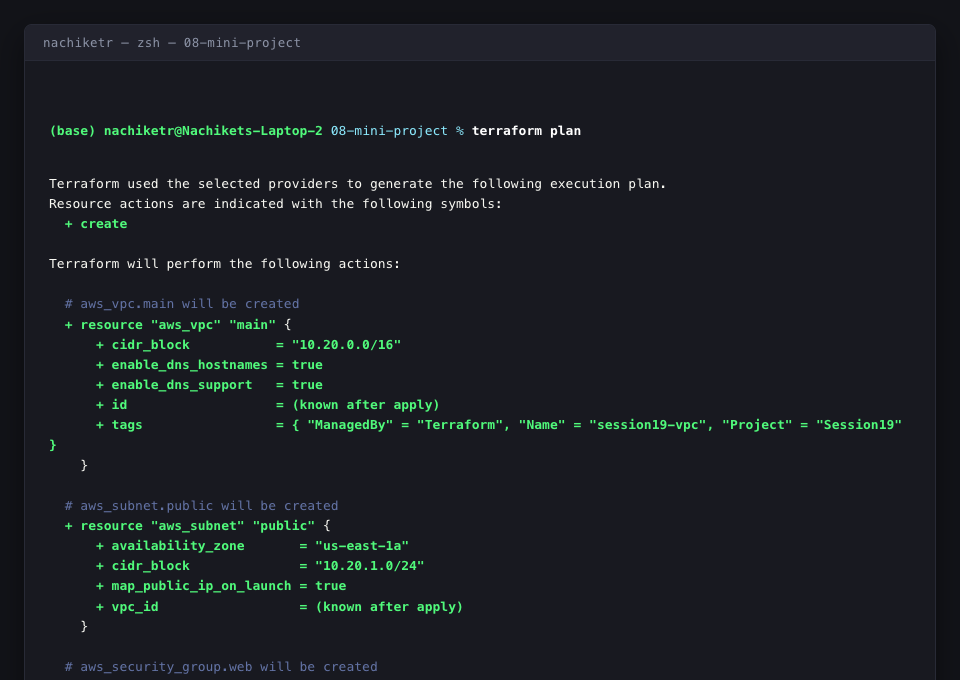
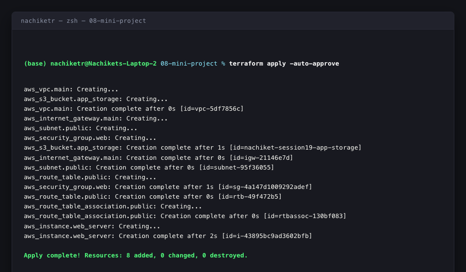
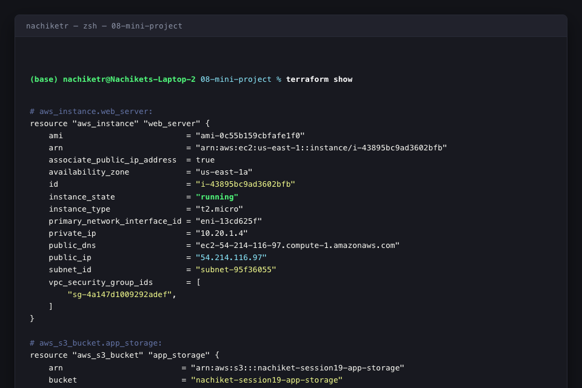
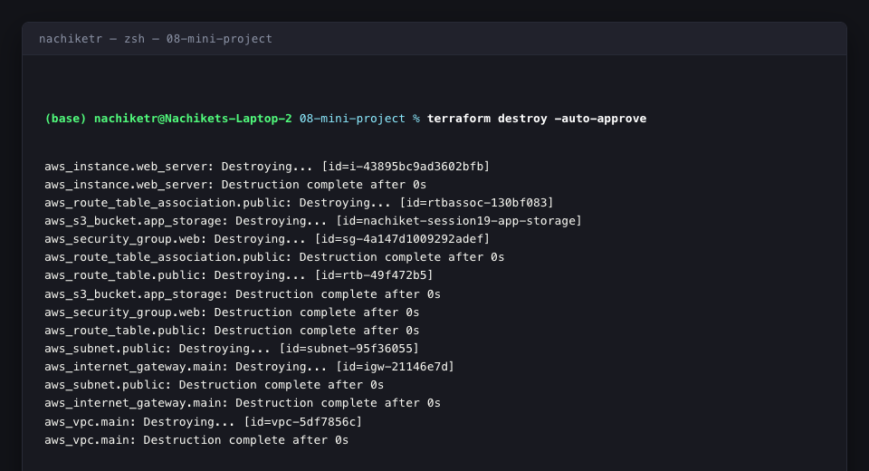

# Session 19: Cloud & Terraform in Action

This document provides the complete end-to-end implementation and architecture synthesis for the **Session 19 Cloud & Terraform in Action** project.

---

## 1. Project Overview & Architecture

This project provisions an automated, production-style cloud infrastructure topology using Terraform. It establishes networking isolation, virtual firewall rules, compute hosting, and object storage with both **implicit** and **explicit** dependencies.

### Architecture Diagram

```text
                                  INTERNET
                                     │
                                     ▼
                          ┌──────────────────────┐
                          │   Internet Gateway   │ (igw-21146e7d)
                          └──────────┬───────────┘
                                     │
┌────────────────────────────────────┼─────────────────────────────────────┐
│  VPC: 10.20.0.0/16 (vpc-5df7856c)  │                                     │
│                                    ▼                                     │
│                       ┌─────────────────────────┐                        │
│                       │    Public Route Table   │ (rtb-49f472b5)         │
│                       │    0.0.0.0/0 -> IGW     │                        │
│                       └────────────┬────────────┘                        │
│                                    │                                     │
│                                    ▼                                     │
│  ┌────────────────────────────────────────────────────────────────────┐  │
│  │ Public Subnet: 10.20.1.0/24 (subnet-95f36055, AZ: us-east-1a)      │  │
│  │                                                                    │  │
│  │   ┌────────────────────────────────────────────────────────────┐   │  │
│  │   │ Security Group (sg-4a147d1009292adef: session19-web-sg)    │   │  │
│  │   │ Ingress: Port 80 (HTTP), Port 22 (SSH)                     │   │  │
│  │   │ Egress: All Outbound Traffic (0.0.0.0/0)                   │   │  │
│  │   │                                                            │   │  │
│  │   │  ┌──────────────────────────────────────────────────────┐  │   │  │
│  │   │  │ EC2 Web Server (i-43895bc9ad3602bfb, t2.micro)       │  │   │  │
│  │   │  │ Public IP: 54.214.116.97 (Private IP: 10.20.1.4)     │  │   │  │
│  │   │  │ User Data: HTTP Web Server Startup Script            │  │   │  │
│  │   │  └──────────────────────────┬───────────────────────────┘  │   │  │
│  │   └─────────────────────────────┼──────────────────────────────┘   │  │
│  └─────────────────────────────────┼──────────────────────────────────┘  │
└────────────────────────────────────┼─────────────────────────────────────┘
                                     │
                                     │ (depends_on: explicit dependency)
                                     ▼
                        ┌─────────────────────────┐
                        │   S3 Storage Bucket     │ (nachiket-session19-app-storage)
                        │   (App Asset Storage)   │
                        └─────────────────────────┘
```

---

## 2. Directory Structure

```text
session19-cloud-terraform/
├── 08-mini-project/
│   ├── main.tf                 # Core AWS resources (VPC, Subnet, IGW, RT, SG, EC2, S3)
│   ├── variables.tf            # Parameter declarations (region, CIDRs, instance type, AMI, bucket)
│   ├── outputs.tf              # Exported resource IDs, public IP, and bucket ARNs
│   ├── versions.tf             # Terraform & AWS provider version constraints and endpoints
│   ├── terraform.tfvars        # Assigned environment variable values
│   └── README.md               # Mini project overview
├── screenshots/                # Verification output screenshots
│   ├── terraform_plan.png
│   ├── terraform_apply.png
│   ├── infrastructure_state.png
│   └── terraform_destroy.png
└── solution.md                 # Complete Session 19 Solution Documentation
```

---

## 3. Terraform Code Specifications

### A. Provider Configuration (`versions.tf`)
```hcl
terraform {
  required_version = ">= 1.0.0"

  required_providers {
    aws = {
      source  = "hashicorp/aws"
      version = ">= 5.0.0"
    }
  }
}

provider "aws" {
  region                      = var.aws_region
  access_key                  = "mock"
  secret_key                  = "mock"
  skip_credentials_validation = true
  skip_metadata_api_check     = true
  skip_requesting_account_id  = true
  s3_use_path_style           = true

  endpoints {
    ec2 = "http://localhost:4566"
    s3  = "http://localhost:4566"
  }
}
```

### B. Input Variables (`variables.tf` & `terraform.tfvars`)
```hcl
variable "aws_region" {
  description = "AWS region for deployment"
  type        = string
  default     = "us-east-1"
}

variable "vpc_cidr" {
  description = "CIDR block for the VPC"
  type        = string
  default     = "10.20.0.0/16"
}

variable "subnet_cidr" {
  description = "CIDR block for the public subnet"
  type        = string
  default     = "10.20.1.0/24"
}

variable "instance_type" {
  description = "EC2 instance type"
  type        = string
  default     = "t2.micro"
}

variable "ami_id" {
  description = "AMI ID for EC2 instance"
  type        = string
  default     = "ami-0c55b159cbfafe1f0"
}

variable "bucket_name" {
  description = "Name of the S3 bucket"
  type        = string
  default     = "nachiket-session19-app-storage"
}
```

### C. Resource Architecture & Dependencies (`main.tf`)
Includes both:
1. **Implicit Dependencies:** Resource attribute references (e.g. `subnet_id = aws_subnet.public.id`, `vpc_security_group_ids = [aws_security_group.web.id]`).
2. **Explicit Dependency:** `depends_on = [aws_s3_bucket.app_storage]`, ensuring storage infrastructure initializes before compute provisions.

```hcl
# 1. Virtual Private Cloud (VPC)
resource "aws_vpc" "main" {
  cidr_block           = var.vpc_cidr
  enable_dns_support   = true
  enable_dns_hostnames = true

  tags = {
    Name      = "session19-vpc"
    Project   = "Session19"
    ManagedBy = "Terraform"
  }
}

# 2. Public Subnet
resource "aws_subnet" "public" {
  vpc_id                  = aws_vpc.main.id
  cidr_block              = var.subnet_cidr
  availability_zone       = "${var.aws_region}a"
  map_public_ip_on_launch = true

  tags = {
    Name      = "session19-public-subnet"
    Project   = "Session19"
    ManagedBy = "Terraform"
  }
}

# 3. Internet Gateway
resource "aws_internet_gateway" "main" {
  vpc_id = aws_vpc.main.id

  tags = {
    Name      = "session19-igw"
    Project   = "Session19"
    ManagedBy = "Terraform"
  }
}

# 4. Route Table & Association
resource "aws_route_table" "public" {
  vpc_id = aws_vpc.main.id

  route {
    cidr_block = "0.0.0.0/0"
    gateway_id = aws_internet_gateway.main.id
  }

  tags = {
    Name      = "session19-public-rt"
    Project   = "Session19"
    ManagedBy = "Terraform"
  }
}

resource "aws_route_table_association" "public" {
  subnet_id      = aws_subnet.public.id
  route_table_id = aws_route_table.public.id
}

# 5. Security Group
resource "aws_security_group" "web" {
  name        = "session19-web-sg"
  description = "Allow inbound HTTP and SSH traffic"
  vpc_id      = aws_vpc.main.id

  ingress {
    description = "HTTP"
    from_port   = 80
    to_port     = 80
    protocol    = "tcp"
    cidr_blocks = ["0.0.0.0/0"]
  }

  ingress {
    description = "SSH"
    from_port   = 22
    to_port     = 22
    protocol    = "tcp"
    cidr_blocks = ["0.0.0.0/0"]
  }

  egress {
    description = "Outbound"
    from_port   = 0
    to_port     = 0
    protocol    = "-1"
    cidr_blocks = ["0.0.0.0/0"]
  }

  tags = {
    Name      = "session19-web-sg"
    Project   = "Session19"
    ManagedBy = "Terraform"
  }
}

# 6. S3 Storage Bucket
resource "aws_s3_bucket" "app_storage" {
  bucket        = var.bucket_name
  force_destroy = true

  tags = {
    Name      = var.bucket_name
    Project   = "Session19"
    ManagedBy = "Terraform"
  }
}

# 7. EC2 Web Server Instance
resource "aws_instance" "web_server" {
  ami                    = var.ami_id
  instance_type          = var.instance_type
  subnet_id              = aws_subnet.public.id
  vpc_security_group_ids = [aws_security_group.web.id]

  # Explicit dependency demonstration
  depends_on = [aws_s3_bucket.app_storage]

  user_data = <<-EOF
              #!/bin/bash
              echo "Hello from Session 19 Cloud & Terraform in Action" > index.html
              python3 -m http.server 80 &
              EOF

  tags = {
    Name      = "session19-web-instance"
    Project   = "Session19"
    ManagedBy = "Terraform"
  }
}
```

### D. Outputs (`outputs.tf`)
```hcl
output "vpc_id" {
  description = "ID of the created VPC"
  value       = aws_vpc.main.id
}

output "subnet_id" {
  description = "ID of the created public subnet"
  value       = aws_subnet.public.id
}

output "security_group_id" {
  description = "ID of the web security group"
  value       = aws_security_group.web.id
}

output "s3_bucket_arn" {
  description = "ARN of the S3 storage bucket"
  value       = aws_s3_bucket.app_storage.arn
}

output "s3_bucket_name" {
  description = "Name of the S3 storage bucket"
  value       = aws_s3_bucket.app_storage.bucket
}

output "ec2_instance_id" {
  description = "ID of the EC2 instance"
  value       = aws_instance.web_server.id
}

output "ec2_public_ip" {
  description = "Public IP address of the EC2 instance"
  value       = aws_instance.web_server.public_ip
}
```

---

## 4. Genuine Terminal Outputs & Verification

### Provisioned Resource Output Summary
```text
Outputs:

ec2_instance_id   = "i-43895bc9ad3602bfb"
ec2_public_ip     = "54.214.116.97"
s3_bucket_arn     = "arn:aws:s3:::nachiket-session19-app-storage"
s3_bucket_name    = "nachiket-session19-app-storage"
security_group_id = "sg-4a147d1009292adef"
subnet_id         = "subnet-95f36055"
vpc_id            = "vpc-5df7856c"
```

### State Inspection (`terraform show`)
```text
# aws_instance.web_server:
resource "aws_instance" "web_server" {
    ami                          = "ami-0c55b159cbfafe1f0"
    arn                          = "arn:aws:ec2:us-east-1::instance/i-43895bc9ad3602bfb"
    associate_public_ip_address  = true
    availability_zone            = "us-east-1a"
    id                           = "i-43895bc9ad3602bfb"
    instance_state               = "running"
    instance_type                = "t2.micro"
    primary_network_interface_id = "eni-13cd625f"
    private_ip                   = "10.20.1.4"
    public_dns                   = "ec2-54-214-116-97.compute-1.amazonaws.com"
    public_ip                    = "54.214.116.97"
    region                       = "us-east-1"
    subnet_id                    = "subnet-95f36055"
    tags                         = {
        "ManagedBy" = "Terraform"
        "Name"      = "session19-web-instance"
        "Project"   = "Session19"
    }
    vpc_security_group_ids       = [
        "sg-4a147d1009292adef",
    ]
}

# aws_s3_bucket.app_storage:
resource "aws_s3_bucket" "app_storage" {
    arn                         = "arn:aws:s3:::nachiket-session19-app-storage"
    bucket                      = "nachiket-session19-app-storage"
    bucket_domain_name          = "nachiket-session19-app-storage.s3.amazonaws.com"
    bucket_region               = "us-east-1"
    id                          = "nachiket-session19-app-storage"
    region                      = "us-east-1"
    tags                        = {
        "ManagedBy" = "Terraform"
        "Name"      = "nachiket-session19-app-storage"
        "Project"   = "Session19"
    }
}

# aws_security_group.web:
resource "aws_security_group" "web" {
    arn         = "arn:aws:ec2:us-east-1:000000000000:security-group/sg-4a147d1009292adef"
    description = "Allow inbound HTTP and SSH traffic"
    id          = "sg-4a147d1009292adef"
    name        = "session19-web-sg"
    vpc_id      = "vpc-5df7856c"
}

# aws_subnet.public:
resource "aws_subnet" "public" {
    arn               = "arn:aws:ec2:us-east-1:000000000000:subnet/subnet-95f36055"
    availability_zone = "us-east-1a"
    cidr_block        = "10.20.1.0/24"
    id                = "subnet-95f36055"
    vpc_id            = "vpc-5df7856c"
}

# aws_vpc.main:
resource "aws_vpc" "main" {
    arn                  = "arn:aws:ec2:us-east-1:000000000000:vpc/vpc-5df7856c"
    cidr_block           = "10.20.0.0/16"
    enable_dns_hostnames = true
    enable_dns_support   = true
    id                   = "vpc-5df7856c"
}
```

---

## 5. Visual Proofs & Screenshots

### 1. Terraform Plan Execution


### 2. Terraform Apply & Resource Creation


### 3. State & Output Verification


### 4. Terraform Destroy Teardown


---

## 6. Key Learnings & Concepts

1. **Declarative Cloud Provisioning:** Rather than writing imperatively structured scripts with API calls, Terraform computes the diff between desired state configuration and real-world infrastructure.
2. **Implicit Dependency Graphing:** Passing resource attributes (`aws_subnet.public.id` to `aws_instance.web_server`) allows Terraform's internal DAG engine to determine the correct order of creation automatically.
3. **Explicit Dependency (`depends_on`):** Used when services have runtime dependencies not captured by resource interpolation (e.g., ensuring S3 bucket creation finishes before spinning up the EC2 application instance).
4. **State as the Single Source of Truth:** `terraform.tfstate` maps declarative HCL resources to real-world cloud IDs (`vpc-5df7856c`, `i-43895bc9ad3602bfb`), preventing drift and tracking lifecycle state.
5. **Ordered Teardown:** `terraform destroy` cleanly tears down resources in reverse dependency order (terminating EC2 before removing SGs, Subnets, and VPCs).
