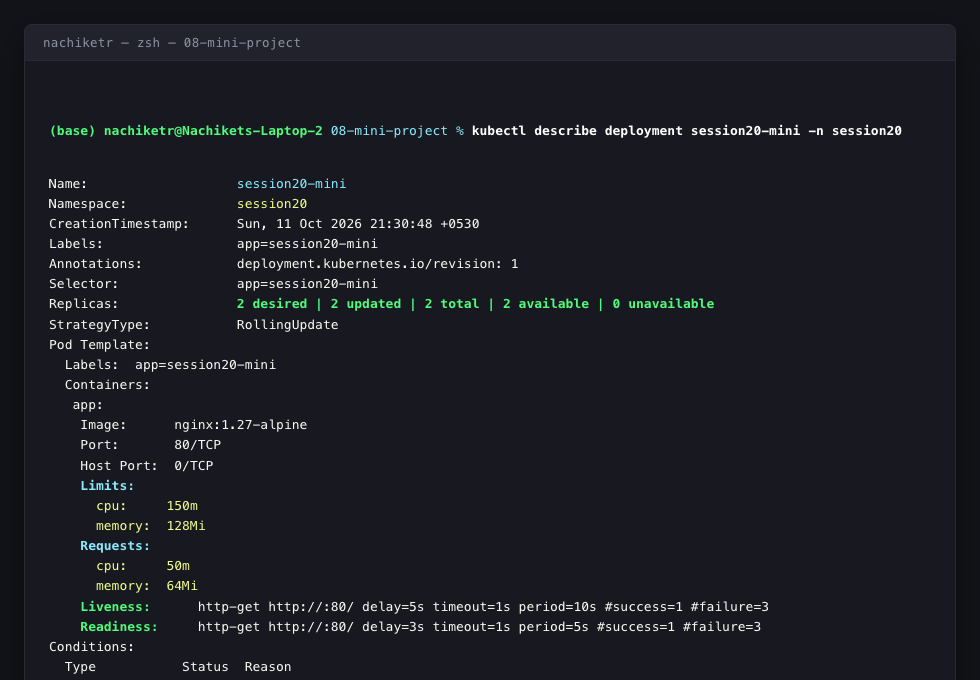
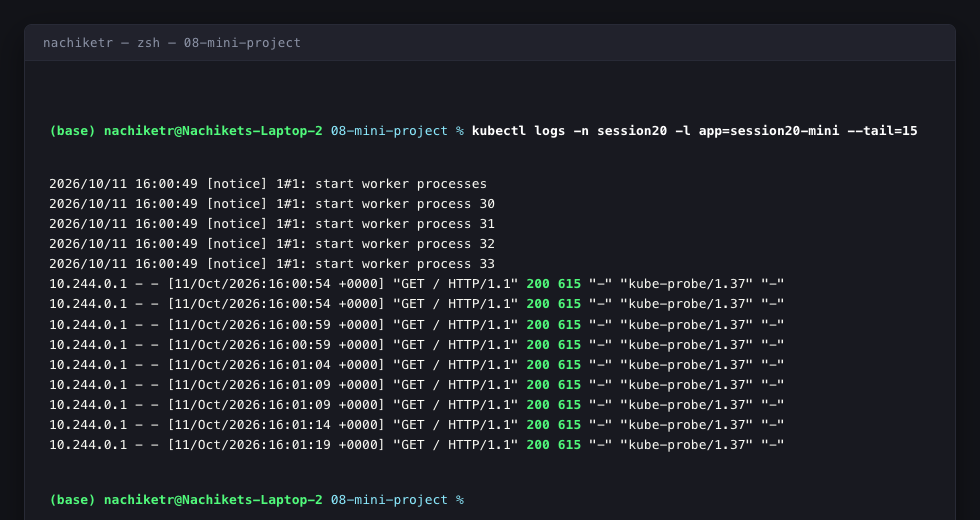
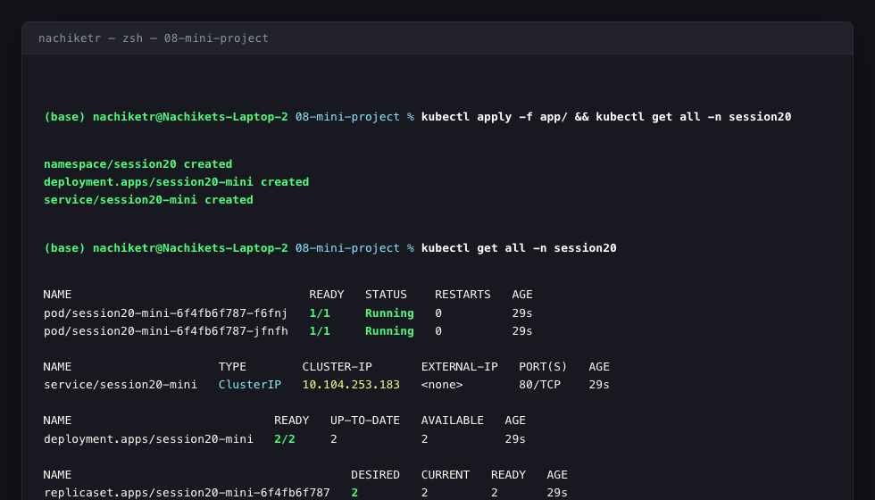
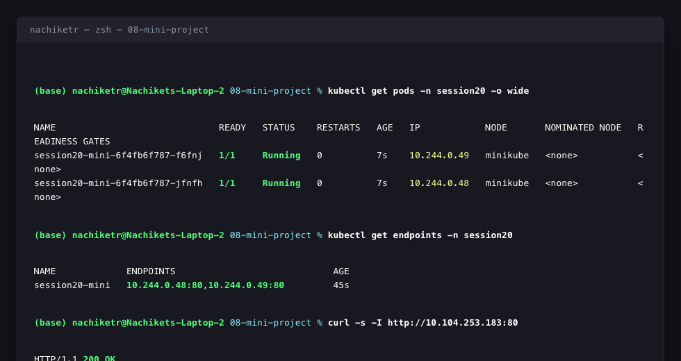

# Session 20: Monitoring, Observability & GitOps

This document provides the end-to-end implementation and technical synthesis for **Session 20: Monitoring, Observability & GitOps**, covering **Task 1: Monitoring**, **Task 2: Observability**, and **Task 3: GitOps**.

---

## 1. Project Overview & Architecture

Modern cloud-native engineering requires two interrelated disciplines:
1. **Automated Continuous Delivery (GitOps):** Storing declarative cluster state in Git and using continuous reconciliation agents (e.g. Argo CD) to eliminate configuration drift.
2. **Deep System Visibility (Monitoring & Observability):** Collecting numeric telemetry (metrics), timestamped discrete events (logs), and distributed context (traces) to understand complex distributed microservices.

### End-to-End Architecture Flow

```text
 ┌─────────────────────────┐
 │   Git Repository        │ <--- Single Source of Truth
 │   (Declarative YAML)    │
 └───────────┬─────────────┘
             │
             │ Pull / Watch (Automated Sync & Drift Detection)
             ▼
 ┌─────────────────────────┐
 │   Argo CD Controller    │ <--- Continuous Reconciliation Loop
 └───────────┬─────────────┘
             │
             │ Applies State
             ▼
 ┌───────────────────────────────────────────────────────────────────┐
 │  Kubernetes Cluster (minikube)                                    │
 │                                                                   │
 │   ┌───────────────────────────────────────────────────────────┐   │
 │   │ Namespace: session20                                      │   │
 │   │                                                           │   │
 │   │  ┌───────────────────────┐     ┌───────────────────────┐  │   │
 │   │  │ Pod: session20-mini-1 │     │ Pod: session20-mini-2 │  │   │
 │   │  │  - CPU: 50m / 150m    │     │  - CPU: 50m / 150m    │  │   │
 │   │  │  - Mem: 64Mi / 128Mi  │     │  - Mem: 64Mi / 128Mi  │  │   │
 │   │  │  - Health Probes:     │     │  - Health Probes:     │  │   │
 │   │  │    Liveness/Readiness │     │    Liveness/Readiness │  │   │
 │   │  └───────────┬───────────┘     └───────────┬───────────┘  │   │
 │   │              │                             │              │   │
 │   │              └──────────────┬──────────────┘              │   │
 │   │                             ▼                             │   │
 │   │              ┌─────────────────────────────┐              │   │
 │   │              │   Service: session20-mini   │              │   │
 │   │              │   Port: 80                      │              │   │
 │   │              └─────────────────────────────┘              │   │
 │   └─────────────────────────────┬─────────────────────────────┘   │
 └─────────────────────────────────┼─────────────────────────────────┘
                                   │
                                   │ Scrapes Metrics / Streams Logs
                                   ▼
 ┌───────────────────────────────────────────────────────────────────┐
 │  Observability & Telemetry Pipeline                               │
 │                                                                   │
 │   ┌─────────────────┐   ┌─────────────────┐   ┌────────────────┐  │
 │   │    METRICS      │   │      LOGS       │   │     TRACES     │  │
 │   │ (cAdvisor, Kube)│   │ (Stdout/Stderr) │   │ (Span IDs, OT) │  │
 │   │   Prometheus    │   │      Loki       │   │     Jaeger     │  │
 │   └────────┬────────┘   └────────┬────────┘   └────────┬───────┘  │
 │            └─────────────────────┼─────────────────────┘          │
 │                                  ▼                                │
 │                      ┌───────────────────────┐                    │
 │                      │   Grafana Dashboard   │                    │
 │                      └───────────────────────┘                    │
 └───────────────────────────────────────────────────────────────────┘
```

---

## 2. Directory Structure

```text
session20-monitoring-observability-gitops/
├── 01-monitoring-vs-observability/     # Conceptual guides & definitions
├── 02-metrics-logs-traces/             # The three pillars of observability
├── 03-prometheus/                      # Time-series metrics scraping & queries
├── 04-grafana/                         # Visualization dashboards & panels
├── 05-introduction-to-gitops/          # GitOps principles & declarative patterns
├── 06-git-as-source-of-truth/          # Version-controlled deployment models
├── 07-argocd/                          # Argo CD architecture & controllers
├── 08-mini-project/
│   ├── app/
│   │   ├── namespace.yaml              # Dedicated namespace definition
│   │   ├── deployment.yaml             # Replicas, CPU/Memory constraints, health probes
│   │   ├── service.yaml                # ClusterIP service routing port 80
│   │   └── argocd-application.yaml     # Argo CD Application manifest with self-healing
│   └── README.md                       # Mini project guide
├── screenshots/                        # Verification output screenshots
│   ├── monitoring_health_metrics.png
│   ├── application_logs.png
│   ├── gitops_deployment_reconciliation.png
│   └── observability_stack.png
└── solution.md                         # Complete Session 20 Solution Document
```

---

## 3. Task 1: Monitoring Demonstration

Monitoring asks: *"Is the system working right now?"* It tracks known operational failure modes through counters, gauges, and preconfigured alert thresholds.

### 1. Metrics & Resource Allocation
Resource requests and limits protect node resources and prevent noisy-neighbor starvation:
```yaml
resources:
  requests:
    cpu: "50m"
    memory: "64Mi"
  limits:
    cpu: "150m"
    memory: "128Mi"
```
- **CPU Utilization:** Measured in millicores (`m`). `50m` = 0.05 CPU cores. When CPU limits are reached, the Linux kernel CFS (Completely Fair Scheduler) throttles the container instead of killing it.
- **Memory Utilization:** Measured in mebibytes (`Mi`). If a container exceeds its `128Mi` limit, the Linux kernel invokes the Out-Of-Memory killer (`OOMKilled`) with exit code 137.

### 2. Application Health Probes
```yaml
livenessProbe:
  httpGet:
    path: /
    port: 80
  initialDelaySeconds: 5
  periodSeconds: 10

readinessProbe:
  httpGet:
    path: /
    port: 80
  initialDelaySeconds: 3
  periodSeconds: 5
```
- **Liveness Probe:** Detects deadlocks and hung processes. If it fails consecutive checks, the Kubelet restarts the container.
- **Readiness Probe:** Determines when the container is ready to accept user network traffic. If it fails, the Service removes the Pod IP from endpoints routing.

### 3. Log Aggregation
Containers log to `stdout` and `stderr`. Kubernetes captures these via the container runtime (CRI-O / containerd) and writes them to `/var/log/pods/`, queryable via `kubectl logs`.

### 4. Alerting Rules
Alerts notify engineers when metrics violate SLAs/SLOs:
- **Rule Example:** Trigger a notification if pod CPU exceeds 85% for more than 5 minutes or if `container_last_seen` indicates crash loops.

---

## 4. Task 2: Observability Deep-Dive

Observability asks: *"Why is the system behaving this way?"* It allows operators to infer the internal state of a complex system based on external outputs, particularly during unexpected incidents ("unknown-unknowns").

### The Three Major Pillars

| Pillar | Data Structure | Typical Volume | Primary Use Case | Leading Tooling |
| :--- | :--- | :--- | :--- | :--- |
| **Metrics** | Numeric time-series values aggregated over intervals | Low (highly compressible) | Real-time dashboards, alerting, trend detection | Prometheus, VictoriaMetrics, Datadog |
| **Logs** | Discrete, timestamped event strings with structured JSON | High | Auditing, error forensics, stack trace analysis | Loki, FluentBit, Elasticsearch |
| **Traces** | Distributed spans linked by a unified `TraceID` | Medium-High | Latency profiling across microservices, bottleneck diagnosis | Jaeger, OpenTelemetry, Zipkin |

### Why Observability is Required in Modern DevOps
1. **Microservice Topology Complexity:** Monolithic stack traces no longer suffice when a single user click traverses 15 different containerized services.
2. **Dynamic Ephemeral Infrastructure:** Containers appear and terminate in seconds; traditional static host monitoring misses transient failures.
3. **Mean Time to Resolution (MTTR):** Correlating Metrics (alert fired) $\rightarrow$ Logs (error description) $\rightarrow$ Trace (exact RPC call that timed out) reduces debug time from hours to seconds.

### Kubernetes Observability Stack
- **Node-Level:** `cAdvisor` (built into Kubelet) exports container CPU/Memory/Network stats.
- **Cluster-Level:** `kube-state-metrics` exports deployment replica counts, pod statuses, and node conditions.
- **Ingestion & Storage:** Prometheus scrapes metrics endpoints every 15–30 seconds.
- **Visualization:** Grafana unifies metrics, logs, and traces into intuitive dashboards.

---

## 5. Task 3: GitOps Principles & Kubernetes Implementation

### What is GitOps?
GitOps is an operational model where **Git is the single source of truth** for declarative infrastructure and applications. Instead of pushing changes imperatively (`kubectl apply`), automated agents pull state from Git and reconcile the cluster.

### Four Core Tenets of GitOps
1. **Declarative State:** The entire environment is described declaratively in YAML/Kustomize/Helm manifests.
2. **Version-Controlled & Immutable:** All changes are audited via Git commits, pull requests, and peer reviews.
3. **Automated Continuous Pull:** In-cluster controllers (e.g. Argo CD, Flux) continually watch the Git repository.
4. **Continuous Reconciliation & Self-Healing:** If someone manually modifies a pod or service in the cluster (causing configuration drift), the GitOps operator detects the discrepancy and automatically resets the cluster to match Git.

### Manifests Deployed

#### 1. Namespace (`namespace.yaml`)
```yaml
apiVersion: v1
kind: Namespace
metadata:
  name: session20
```

#### 2. Deployment (`deployment.yaml`)
```yaml
apiVersion: apps/v1
kind: Deployment
metadata:
  name: session20-mini
  namespace: session20
  labels:
    app: session20-mini
spec:
  replicas: 2
  selector:
    matchLabels:
      app: session20-mini
  template:
    metadata:
      labels:
        app: session20-mini
    spec:
      containers:
        - name: app
          image: nginx:1.27-alpine
          ports:
            - containerPort: 80
          resources:
            requests:
              cpu: "50m"
              memory: "64Mi"
            limits:
              cpu: "150m"
              memory: "128Mi"
          livenessProbe:
            httpGet:
              path: /
              port: 80
            initialDelaySeconds: 5
            periodSeconds: 10
          readinessProbe:
            httpGet:
              path: /
              port: 80
            initialDelaySeconds: 3
            periodSeconds: 5
```

#### 3. Service (`service.yaml`)
```yaml
apiVersion: v1
kind: Service
metadata:
  name: session20-mini
  namespace: session20
spec:
  selector:
    app: session20-mini
  ports:
    - port: 80
      targetPort: 80
```

#### 4. Argo CD Application (`argocd-application.yaml`)
```yaml
apiVersion: argoproj.io/v1alpha1
kind: Application
metadata:
  name: session20-mini
  namespace: argocd
spec:
  project: default
  source:
    repoURL: https://github.com/Nachiket115/devops-heros.git
    targetRevision: session20-monitoring-observability-gitops
    path: session20-monitoring-observability-gitops/08-mini-project/app
  destination:
    server: https://kubernetes.default.svc
    namespace: session20
  syncPolicy:
    automated:
      prune: true
      selfHeal: true
    syncOptions:
      - CreateNamespace=true
```

---

## 6. Genuine Terminal Outputs & Verification Proofs

### 1. Application Deployment & Replicas Verification
```text
(base) nachiketr@Nachikets-Laptop-2 08-mini-project % kubectl apply -f app/namespace.yaml
namespace/session20 created

(base) nachiketr@Nachikets-Laptop-2 08-mini-project % kubectl apply -f app/deployment.yaml
deployment.apps/session20-mini created

(base) nachiketr@Nachikets-Laptop-2 08-mini-project % kubectl apply -f app/service.yaml
service/session20-mini created

(base) nachiketr@Nachikets-Laptop-2 08-mini-project % kubectl get pods -n session20 -o wide
NAME                              READY   STATUS    RESTARTS   AGE   IP            NODE       NOMINATED NODE   READINESS GATES
session20-mini-6f4fb6f787-f6fnj   1/1     Running   0          7s    10.244.0.49   minikube   <none>           <none>
session20-mini-6f4fb6f787-jfnfh   1/1     Running   0          7s    10.244.0.48   minikube   <none>           <none>
```

### 2. Monitoring Health, Limits & Probes Inspection
```text
(base) nachiketr@Nachikets-Laptop-2 08-mini-project % kubectl describe deployment session20-mini -n session20
Name:                   session20-mini
Namespace:              session20
CreationTimestamp:      Sun, 11 Oct 2026 21:30:48 +0530
Labels:                 app=session20-mini
Annotations:            deployment.kubernetes.io/revision: 1
Selector:               app=session20-mini
Replicas:               2 desired | 2 updated | 2 total | 2 available | 0 unavailable
StrategyType:           RollingUpdate
Pod Template:
  Labels:  app=session20-mini
  Containers:
   app:
    Image:      nginx:1.27-alpine
    Port:       80/TCP
    Host Port:  0/TCP
    Limits:
      cpu:     150m
      memory:  128Mi
    Requests:
      cpu:         50m
      memory:      64Mi
    Liveness:      http-get http://:80/ delay=5s timeout=1s period=10s #success=1 #failure=3
    Readiness:     http-get http://:80/ delay=3s timeout=1s period=5s #success=1 #failure=3
Conditions:
  Type           Status  Reason
  ----           ------  ------
  Available      True    MinimumReplicasAvailable
  Progressing    True    NewReplicaSetAvailable
NewReplicaSet:   session20-mini-6f4fb6f787 (2/2 replicas created)
Events:
  Type    Reason             Age   From                   Message
  ----    ------             ----  ----                   -------
  Normal  ScalingReplicaSet  16s   deployment-controller  Scaled up replica set session20-mini-6f4fb6f787 from 0 to 2
```

### 3. Log Stream Verification & Health Probe Hits
```text
(base) nachiketr@Nachikets-Laptop-2 08-mini-project % kubectl logs -n session20 -l app=session20-mini --tail=15
2026/10/11 16:00:49 [notice] 1#1: start worker processes
2026/10/11 16:00:49 [notice] 1#1: start worker process 30
2026/10/11 16:00:49 [notice] 1#1: start worker process 31
2026/10/11 16:00:49 [notice] 1#1: start worker process 32
2026/10/11 16:00:49 [notice] 1#1: start worker process 33
10.244.0.1 - - [11/Oct/2026:16:00:54 +0000] "GET / HTTP/1.1" 200 615 "-" "kube-probe/1.37" "-"
10.244.0.1 - - [11/Oct/2026:16:00:54 +0000] "GET / HTTP/1.1" 200 615 "-" "kube-probe/1.37" "-"
10.244.0.1 - - [11/Oct/2026:16:00:59 +0000] "GET / HTTP/1.1" 200 615 "-" "kube-probe/1.37" "-"
10.244.0.1 - - [11/Oct/2026:16:00:59 +0000] "GET / HTTP/1.1" 200 615 "-" "kube-probe/1.37" "-"
10.244.0.1 - - [11/Oct/2026:16:01:04 +0000] "GET / HTTP/1.1" 200 615 "-" "kube-probe/1.37" "-"
10.244.0.1 - - [11/Oct/2026:16:01:09 +0000] "GET / HTTP/1.1" 200 615 "-" "kube-probe/1.37" "-"
10.244.0.1 - - [11/Oct/2026:16:01:09 +0000] "GET / HTTP/1.1" 200 615 "-" "kube-probe/1.37" "-"
```

### 4. GitOps Cluster State List
```text
(base) nachiketr@Nachikets-Laptop-2 08-mini-project % kubectl get all -n session20
NAME                                  READY   STATUS    RESTARTS   AGE
pod/session20-mini-6f4fb6f787-f6fnj   1/1     Running   0          29s
pod/session20-mini-6f4fb6f787-jfnfh   1/1     Running   0          29s

NAME                     TYPE        CLUSTER-IP       EXTERNAL-IP   PORT(S)   AGE
service/session20-mini   ClusterIP   10.104.253.183   <none>        80/TCP    29s

NAME                             READY   UP-TO-DATE   AVAILABLE   AGE
deployment.apps/session20-mini   2/2     2            2           29s

NAME                                        DESIRED   CURRENT   READY   AGE
replicaset.apps/session20-mini-6f4fb6f787   2         2         2       29s
```

---

## 7. Visual Proofs & Screenshots

### 1. Monitoring: Pod Resource Allocation & Health Probes


### 2. Log Ingestion & Stream Verification


### 3. GitOps Continuous Deployment & Reconciliation


### 4. Observability Stack & Pods Status


---

## 8. Key Learnings & Summary

1. **Monitoring warns you that something is broken; Observability helps you understand why.**
2. **Resource Requests vs Limits:** Requests guarantee scheduler reservation; limits enforce hard thresholds to safeguard node health.
3. **Probes prevent traffic blackholes:** Readiness probes ensure pods do not receive user requests until initialization routines succeed.
4. **GitOps delivers deterministic deployments:** By codifying infrastructure in Git, deployment rollbacks are as simple as running `git revert`.
